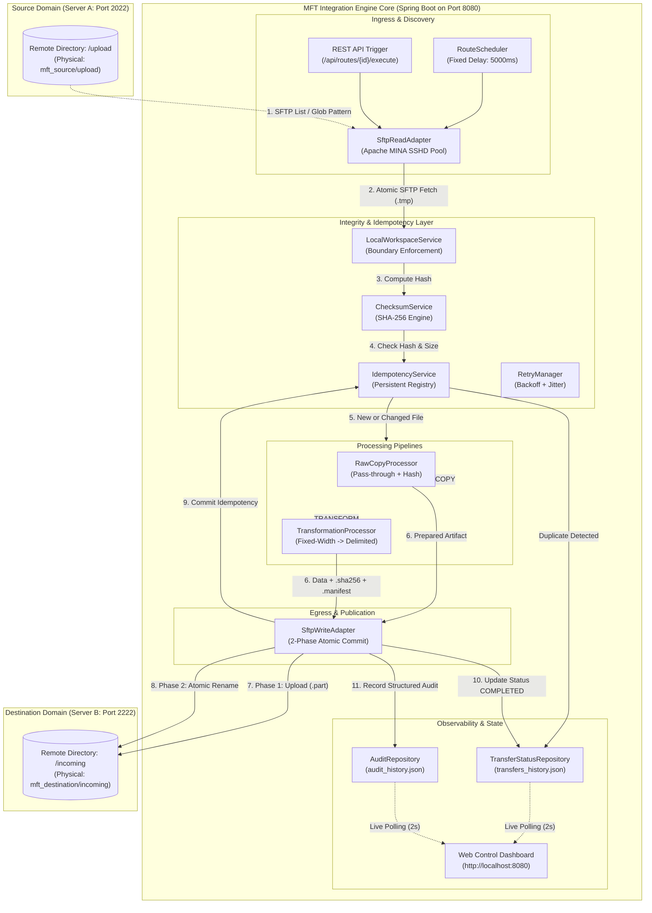
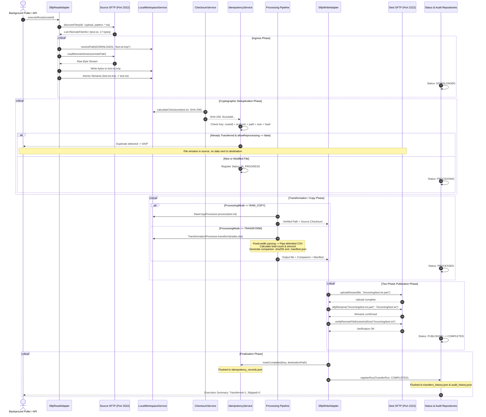
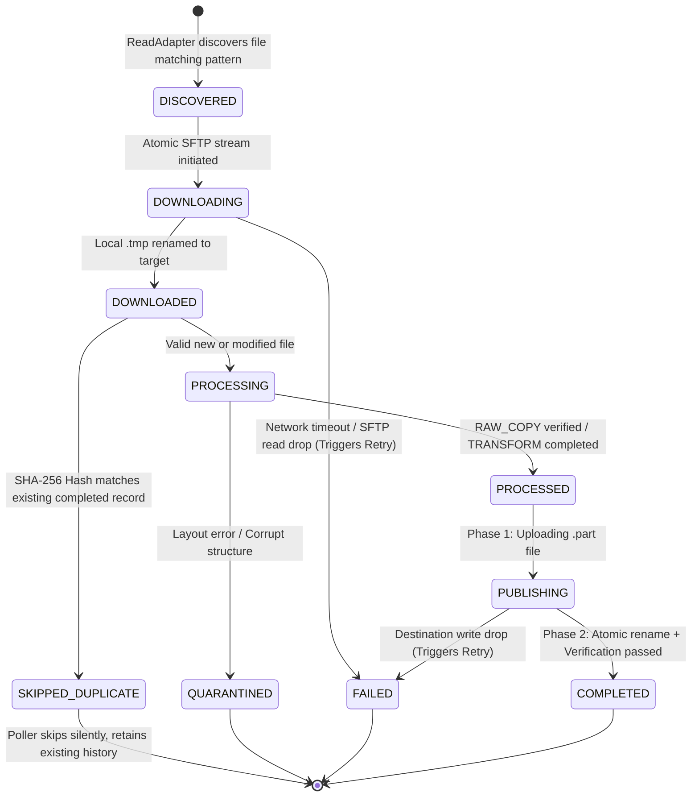

# MFT Enterprise Integration Engine: Architecture & End-to-End File Flow

---

## 1. Executive System Architecture

The **Managed File Transfer (MFT) Integration Engine** is an enterprise-grade file integration platform built in **Java 21** and **Spring Boot 4.2.0**. It orchestrates reliable, idempotent, and auditable file movements between heterogeneous endpoints (demonstrated with dual SFTP servers).



---

## 2. End-to-End File Lifecycle Sequence

The sequence below traces a single file transfer run from discovery through publication:



---

## 3. Core Architectural Subsystems

### 3.1. Dual SFTP Adapter Architecture
* **MINA SSHD Session Pooling:** Connections are managed by `CachingSessionFactory` backed by Apache MINA SSHD. Connections remain open and cached to prevent expensive SSH key-exchange overhead on periodic 5-second polling intervals.
* **Separation of Concerns:**
  * **Source Server A (Ingress):** Port `2022`, pre-seeded with user `mft_source`. Granted download and delete permissions only.
  * **Destination Server B (Egress):** Port `2222`, pre-seeded with user `mft_destination`. Granted full publication permissions (`upload`, `overwrite`, `rename`, `create_dirs`).

### 3.2. Controlled Local Workspace Confinement
To protect against path-traversal vulnerabilities (`..` directory climbing) and guarantee multi-tenant filesystem safety, all file operations occur inside a strictly bounded local workspace:

```
workspace/
├── downloads/      # Incoming raw transfers (atomic .tmp downloads)
├── staging/        # Intermediate files being transformed or enriched
├── output/         # Transformed files, companion .sha256, and .manifest.json
├── quarantine/     # Checksum mismatches or corrupted files isolated here
└── status/         # Persistent JSON state ledgers (survives restarts)
    ├── transfers_history.json
    ├── idempotency_records.json
    └── audit_history.json
```
* **Boundary Validation:** Every file path is validated via `PathValidationUtil.validateLocalWorkspacePath(target, root)`. If an incoming file name contains directory traversal sequences (`../../etc/passwd`), the engine immediately throws a `SecurityException` and quarantines the transaction.

### 3.3. Zero Duplicate Re-Transfer Guarantee (Cryptographic Idempotency)
Unlike naive file transfer tools that compare only file names or modification dates, this engine computes a deterministic SHA-256 idempotency key:

$$\text{Key} = \text{SHA-256}(\text{routeId} : \text{sourceConnectionId} : \text{sourceFilePath} : \text{fileSize} : \text{sourceSha256})$$

* **Disk Persistence:** Records are serialized to disk (`idempotency_records.json`).
* **Engine Boot Rehydration:** When the Spring Boot application starts or restarts, all previously completed hashes are loaded into memory.
* **Guarantee:** If a file sits permanently in `/upload`, the engine identifies it within 5 milliseconds, logs a debug skip, and **never uploads it to destination again**. If the user updates the file content, the SHA-256 hash changes, the key changes, and the new version is immediately transferred.

### 3.4. Two-Phase Atomic Publication Protocol
To prevent downstream systems from consuming half-written or locked files during large network transfers:
1. **Phase 1 (Upload):** The file is streamed to the destination under a temporary suffix:
   `/incoming/payload.dat.part`
2. **Flush & Sync:** The engine flushes all SSH stream buffers and verifies byte count against local payload size.
3. **Phase 2 (Atomic Commit):** The remote SFTP server issues an atomic rename:
   `/incoming/payload.dat.part` $\longrightarrow$ `/incoming/payload.dat`
4. **Post-Commit Verification:** A remote SFTP `stat` query confirms the final file exists and matches the byte length before recording the transfer as `COMPLETED`.

### 3.5. Dual Processing Modes

#### A. `RAW_COPY`
* Direct binary pass-through.
* End-to-end SHA-256 validation (Source hash == Destination hash).
* Zero transformation overhead; ideal for arbitrary document transfers.

#### B. `TRANSFORM`
* **Source:** Fixed-width financial transaction records (`trades.dat`).
* **Processing:**
  1. Parses fixed-width columnar records (Trade ID, Account, Security, Quantity, Price, Currency).
  2. Converts to standard pipe-delimited format (`|`).
  3. Computes batch summary aggregates (Total records, Total settlement amount).
* **Publication Trinity:**
  1. Primary data file: `SL_RECON_YYYYMMDD_<runId>.txt`
  2. Companion checksum: `SL_RECON_YYYYMMDD_<runId>.txt.sha256`
  3. Audit metadata manifest: `SL_RECON_YYYYMMDD_<runId>.txt.manifest.json`

---

## 4. State Transition Diagram

Every file lifecycle is mapped through explicit, immutable status transitions:



---

## 5. Directory & File Mapping Table

| Logical Domain | SFTP Server Path | Local / Physical Host Path | Managed User / Permissions |
| :--- | :--- | :--- | :--- |
| **Source Ingress** | `/upload` | `.../sftpgo/instance-a/data/mft_source/upload` | `mft_source` (`list`, `download`, `delete`) |
| **Destination Egress** | `/incoming` | `.../sftpgo/instance-b/data/mft_destination/incoming` | `mft_destination` (`list`, `download`, `upload`, `overwrite`, `rename`) |
| **Local Staging** | *N/A (Local Engine)* | `.../workspace/downloads/` & `staging/` | Engine Process (Confined boundary) |
| **Quarantine Isolation** | *N/A (Local Engine)* | `.../workspace/quarantine/<runId>/` | Engine Process (Failure reason metadata) |
| **State Registry** | *N/A (Local Engine)* | `.../workspace/status/transfers_history.json` | Persistent ledger for Web Dashboard |
| **Idempotency Cache** | *N/A (Local Engine)* | `.../workspace/status/idempotency_records.json` | SHA-256 deduplication state |

---

## 6. Real-Time Observability & Monitoring

The engine exposes three observability tiers:
1. **Interactive Web Dashboard (`http://localhost:8080`):**
   * Auto-refreshes every 2 seconds via reactive polling.
   * Displays deduplicated transfer history table showing each file's route, status (`COMPLETED`, `FAILED`), byte size, SHA-256 hash, and transfer timestamp.
   * 1-click manual trigger buttons for on-demand execution.
2. **REST APIs:**
   * `/api/health`: Health status of connections, routes, and disk.
   * `/api/transfers`: Full lifecycle history queryable by `routeId` or `runId`.
   * `/api/audit`: Immutable compliance audit trail.
3. **SFTP Administration Dashboards:**
   * Server A Management: `http://localhost:9080/web/admin`
   * Server B Management: `http://localhost:9081/web/admin`
