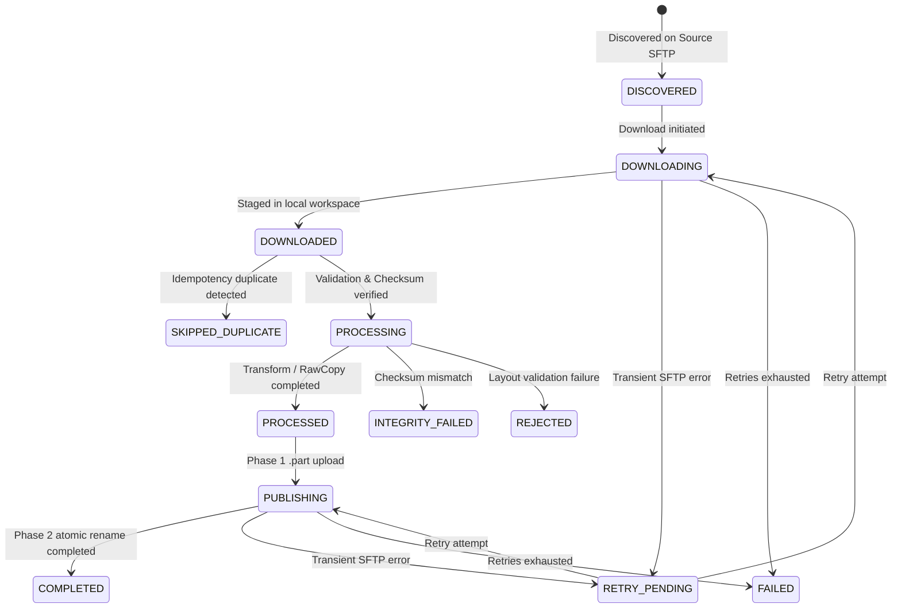

# Transfer Lifecycle Tracking and Audit Subsystem

This document outlines the lifecycle tracking, audit logging, and repository structures in the MFT Integration Engine.

---

## 1. Transfer Run Lifecycle

Every file handled by the integration engine receives a dedicated `TransferRun` instance tracked in `TransferStatusRepository`.

### 1.1 State Transitions

---

## 2. Audit Event Structure

Every significant operational lifecycle event is captured by `AuditService` and persisted in `AuditRepository`.

### 2.1 Audit Schema
| Field | Type | Description |
| :--- | :--- | :--- |
| `eventId` | UUID | Globally unique identifier for this audit event. |
| `timestamp` | Instant | UTC timestamp of event occurrence. |
| `runId` | String | Transfer execution run identifier (`routeId_timestamp_uuid`). |
| `routeId` | String | Configured route ID (e.g. `R_RAW_COPY`, `R_TRANSFORM`). |
| `operation` | String | Operation code (e.g., `DOWNLOAD_START`, `TRANSFER_COMPLETED`, `RETRY_ATTEMPT`, `DUPLICATE_FILE_SKIPPED`). |
| `sourceFile` | String | Source SFTP file path. |
| `destinationFile` | String | Destination SFTP file path. |
| `status` | String | `STARTED`, `IN_PROGRESS`, `COMPLETED`, `SKIPPED`, `FAILED`. |
| `errorCode` | String | Normalized error code (e.g., `TRANSFER_FAILED`, `ATTEMPT_1`, `DUPLICATE`). |
| `details` | String | Diagnostic message, byte counts, and SHA-256 checksums. **Never logs credentials or payload data.** |
